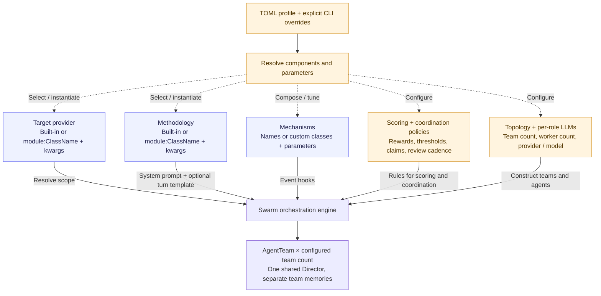
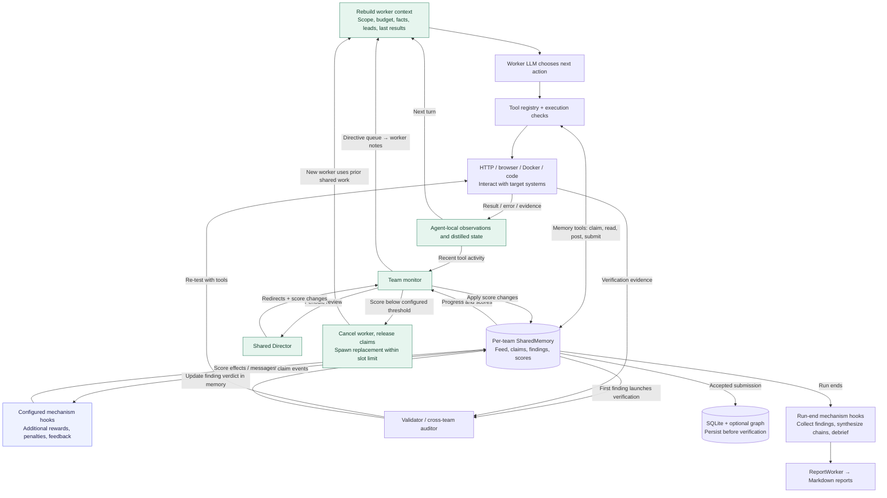

# swarmhound

**A competitive multi-agent framework for autonomous security research.**

swarmhound orchestrates teams of LLM agents that **compete and coordinate** to
test a target — over Docker-sandboxed security tooling, shared memory, and a
director that scores and redirects them in real time. It's model-agnostic,
checkpointable, and fully observable through a live control UI.

Bug bounty is the batteries-included application built on top: program discovery,
ROI ranking, scope enforcement, and submittable reports. But the core is the
**framework** — the orchestration, memory, tooling, and economics — not any one
target or model.

> ⚠️ **Authorized testing only.** swarmhound is built for security research against
> targets you own or are explicitly permitted to test (e.g. an in-scope bug bounty
> program). See [Legal & Ethical Use](#legal--ethical-use) before running it.


*Live dashboard — competing pentester agents, shared memory, a real-time
scoreboard, and cost/budget tracking. God-mode lets you steer the swarm mid-run.*

---

## Why swarmhound

Most "AI hacker" projects wrap a single agent around a shell. swarmhound is a
**framework** for running many of them as a coordinated, competitive operation:

- **Two levels of competition.** *Within* a team, pentester agents cooperate
  through shared memory (claiming work, posting findings, avoiding duplication)
  while a director scores and redirects them on a live scoreboard. *Across* teams
  (`--num-teams N` > 1, same `swarm` engine), multiple teams — each with its
  **own shared memory** — work the same scope. A shared Director reviews
  workers, while a group monitor checks the shared budget. A **cross-team
  auditor** re-tests findings concurrently; submission scoring and persistence
  happen before verification.
  Cooperation inside teams, rivalry between them.
- **Sandboxed tooling.** Every CLI security tool (nmap, nuclei, httpx, sqlmap,
  ffuf, …) runs in a resource-limited Docker container without host filesystem mounts, alongside
  in-process HTTP and browser primitives. A validator agent re-tests findings.
- **Memory & resumability.** A 4-layer memory model (persistent store, per-run
  session, learning, and a knowledge graph) plus checkpoint/resume for long,
  unattended runs.
- **Model-agnostic & economical.** Run any provider (Claude, local Ollama, or
  OpenAI-compatible endpoints like Novita/vLLM) — per-agent. Usage is tracked against an estimated budget. OpenAI-compatible endpoints
  require configured token prices or an explicit free-endpoint setting.
- **Observable & steerable.** A live web UI streams events, reasoning, and a
  scoreboard, with god-mode to redirect the swarm mid-run.

On top of that framework, bug bounty is the built-in domain: program discovery
and ROI ranking across HackerOne, Bugcrowd, Intigriti, and YesWeHack, scope
enforcement, and OWASP:2025 / CWE-classified reports.

## Local benchmark

The reusable [benchmark harness](benchmark/README.md) runs the framework against
intentionally vulnerable local targets. It starts the supplied Docker Compose
services, runs the selected agents, and records findings, cost and class coverage.

```bash
# Inspect the generated command without starting targets or making model calls.
python benchmark/run_benchmark.py --targets juice-shop --dry-run \
    --director-llm claude --worker-llm claude --analyzer-llm claude \
    --budget 8 --agents 3 --timeout 2400
```

See the benchmark guide for installation and a complete run. Results depend on
the model and configuration. The harness's class-match metric is not proof that
an individual finding is exploitable. Personal run results and model-training
experiments are not distributed with the framework.

## Profiles — composable run configuration

Every pluggable piece of a run — how agents think, what's in scope, scoring
values, the optional game-theory mechanism layer, agent-connectivity rules,
per-agent LLM selection, and topology — bundles into one `Profile`
(`profiles/`), loadable from Python or a plain TOML file. The framework's
original/default behavior is `profiles/bugbounty.toml`: not a special case in
code, just data.

```bash
python main.py full --profile profiles/bugbounty.toml --targets <scope> --auto
python main.py full --profile profiles/competitive.toml --targets <scope> --auto   # multi-team, tuned mechanisms
```

| Piece | Config | Built-ins | Extend with |
|---|---|---|---|
| Methodology (how agents think) | `[methodology] type=` | `pentest`, `redteam` | `module:ClassName`, plus free-form config |
| Target source | `[target] provider=` | `auto`, `direct`, `bugbounty` | `module:ClassName` |
| Scoring | `[scoring]` | severity reward, rejection/duplicate penalty, termination threshold | plain data |
| Coordination | `[coordination]` | claim exclusivity, director review cadence, cross-team sharing | plain data |
| Mechanisms (additive game-theory layer) | `[mechanisms]` | `first_finder_bonus`, `duplicate_escalation`, `team_rivalry_pool`, `relative_rank_bonus`, `target_bidding`, `visibility_toggle`, `idle_tax` — each with tunable knobs | `class = "module:ClassName"` |
| LLM per agent | `[llm.director]` / `[llm.default_worker]` / `[llm.overrides.<name>]` | any configured provider | — |
| Topology | `[topology]` | `mode` (`swarm`/`lab`), `agents_per_team`, `num_teams` (>1 = cross-team competition, same engine — not a separate mode) | — |

CLI flags always override a profile's values when given explicitly — a
profile sets defaults, not a lock. `GET /api/profile` exposes the resolved
configuration for a dashboard or any other consumer. See
[`docs/architecture.md`](docs/architecture.md) for the full breakdown.

## Features

- **Program discovery & ROI model** — pulls live scope data, ranks programs by
  expected value vs. scan cost.
- **Agentic tool use** — agents drive Docker-isolated security tools (nmap,
  nuclei, httpx, subfinder, katana, ffuf, sqlmap, nikto, dig, curl) plus HTTP,
  DNS, and browser primitives.
- **Multi-agent modes** — `swarm` (optionally multi-team via `--num-teams`) and `lab` orchestration.
- **4-layer memory** — persistent SQLite store, per-run session memory, a
  learning layer that adapts from outcomes, and an optional FalkorDB knowledge
  graph.
- **Checkpoint & resume** — long runs auto-checkpoint and can resume after a
  crash or interrupt.
- **Pluggable LLMs** — Claude, local models via Ollama, and any
  OpenAI-compatible endpoint (vLLM, Novita, etc.). Providers can be set
  per-agent (director / worker / analyzer).
- **Web dashboard** — real-time event stream, reasoning traces, checkpoints, and
  human-in-the-loop prompts over WebSocket.
- **Browser automation** — shared Chromium pool via Playwright.
- **Reporting** — Jinja2-templated Markdown reports from findings, classified by
  OWASP Top 10:2025 + CWE.

## Architecture

swarmhound composes a run from configurable strategies and policies, then adapts
through tool-result, Director-review, scoring and worker-replacement loops.
[Open the detailed diagrams](docs/architecture.html) in a browser to see both
component composition and runtime feedback (rendering requires internet access).





Profiles select components at startup; they are not hot-reloaded. Each team has
its own memory and workers, while the Director, cost tracker and storage are
shared. Findings persist on submission before validation. See the HTML reference
for hook coverage, live dashboard controls and implementation boundaries.

## Requirements

- Python 3.13+
- [Docker](https://www.docker.com/) — required for the isolated CLI tool sandbox
- (Optional) [Ollama](https://ollama.com/) for local models
- (Optional) [FalkorDB](https://www.falkordb.com/) for the knowledge graph

## Quickstart

```bash
git clone https://github.com/tsirolnik/swarmhound.git
cd swarmhound

python3 -m venv .venv
source .venv/bin/activate
pip install -r requirements.txt
playwright install chromium

# Configure
cp .env.example .env   # then edit .env with your keys / settings

# Build the isolated tool image (used by the security tools)
docker build -t bugbounty-tools:latest -f docker/Dockerfile.tools .
```

At minimum set an LLM provider in `.env` (e.g. `ANTHROPIC_API_KEY`, or point
`OLLAMA_BASE_URL` at a local Ollama). Platform API tokens are optional and only
enhance program discovery.

## Usage

swarmhound is a CLI (`python main.py <command>`):

```bash
# Find high-ROI programs to work
python main.py discover

# Scan a single target
python main.py scan --target example.com

# Run the full pipeline (discovery → recon → scan → analyze → report)
python main.py full --mode swarm --swarm-agents 4 --web

# Show cost breakdown and learning insights
python main.py costs
python main.py learning

# Generate a report from findings
python main.py report --findings output/findings.json
```

Other commands: `fuzz`, `history`, `record-outcome`, `validate`, `graph-sync`.
Run `python main.py <command> --help` for full flags.

Add `--web` to launch the dashboard (port configurable with `--web-port`).
Enter the access token printed in the server terminal on the login page.
Set `WEB_AUTH_TOKEN` to reuse a token; otherwise it changes at each startup.
Keep the default localhost binding. External clients, including event-ingest
hooks, must send `Authorization: Bearer <token>`; WebSockets also require a
matching Origin. A token grants access to findings and run controls.

Scope filtering rejects recognized out-of-scope hosts, including mixed-host
calls. It is not a network firewall: dynamically constructed destinations,
redirects and browser subrequests need external network controls if strict scope
is required. Docker bridge networking can reach host/LAN addresses. Use an
isolated lab for evaluation.

## Configuration

Configuration comes from settings/environment, optional TOML profiles, and CLI
overrides. See [`.env.example`](.env.example) for common environment settings.
Budget accounting is an estimate, not a provider-side spending limit; concurrent
requests may overshoot it.

## Legal & Ethical Use

swarmhound is a security **research** tool. You are responsible for how you use
it.

- Only run it against systems you **own** or are **explicitly authorized** to
  test — for example, assets that are in scope for a bug bounty program you are
  enrolled in.
- Respect each program's scope, rate limits, and rules of engagement. The tool
  provides scope enforcement and rate limiting, but the responsibility is yours.
- Unauthorized scanning or exploitation of systems is illegal in most
  jurisdictions.

The authors accept no liability for misuse or for any damage caused by this
software. See [LICENSE](LICENSE).

## Status

swarmhound is an experimental research framework. Interfaces may change.
Binary fuzzing and autonomous investigation need operator supervision.

## License

[MIT](LICENSE) © Yehonatan Tsirolnik
