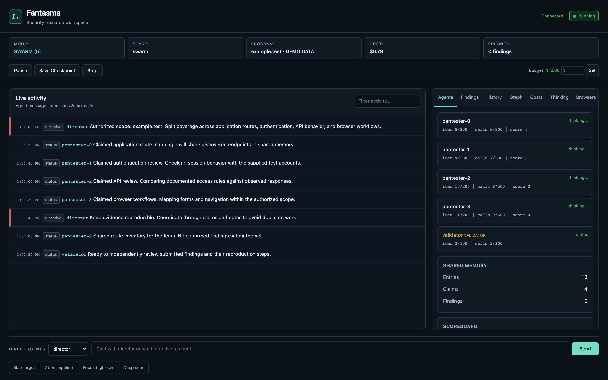
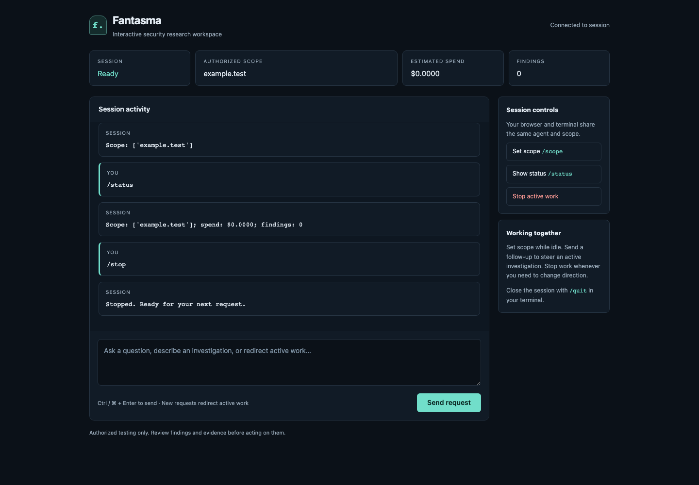
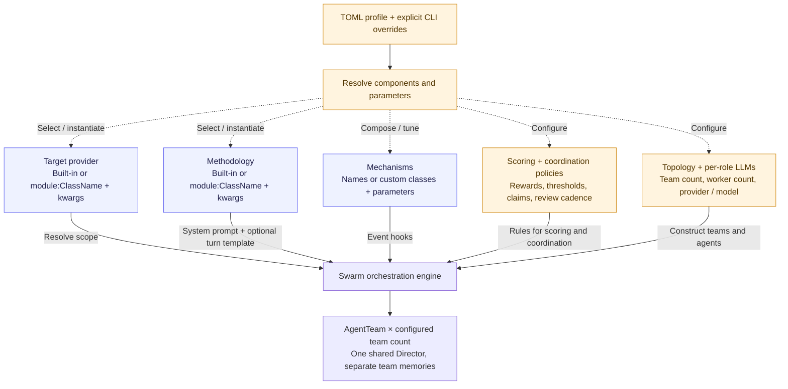

# Fantasma

**A composable multi-agent framework for authorized security research.**

fantasma runs LLM-driven investigators against a shared scope. A run can use
one team or several teams, different models by role, configurable scoring, and
optional incentive mechanisms. Workers choose tools from the evidence they
collect; a Director reviews progress and can redirect them.

The built-in workflows cover web application security research and bug-bounty
program discovery. Profiles let you change the target source, investigation
methodology, coordination rules, models, and team structure without changing the
orchestration code.

**Experimental software.** Use only on systems you own or are explicitly
authorized to test. Findings and generated reports require human review.

## Screenshots

### Full agent dashboard

Follow agent activity, inspect shared context, and track costs across a team.



*Illustrative example data; no live scan or model calls.*

### Interactive workspace

Set scope, send investigation requests, and steer or stop work from the browser.
The browser and terminal share the same session.



*Captured in a local dry-run session; no live scan or model calls.*

See the [dashboard reference](docs/reference/dashboard.md) for controls and setup.
To reproduce these captures, run `python scripts/capture_dashboard.py` and
`python scripts/check_ui.py` with the development dependencies installed.

## Start interactively

After [installation](#install), run `fantasma` to open the default
[interactive pentester](docs/interactive.md). Set `/scope`, ask a question or give
an investigation task, and use `/stop` to cancel active work. It waits for your
request and retains conversation context; it does not launch an unattended scan.

## What is configurable?

A TOML profile describes a run. Named profiles resolve to files in `profiles/`;
explicit CLI options override the corresponding profile options.

| Component | Configuration | What it changes |
|---|---|---|
| Target provider | `[target]` | Explicit targets, program discovery, or a custom source |
| Methodology | `[methodology]` | Worker system instructions and optional turn template |
| Topology | `[topology]` | Engine, teams, and workers per team |
| Interaction | `[interaction] mode` | Terminal or batch interaction, independent of topology |
| Dashboard | `[dashboard] enabled` or `--web` | Optional web companion alongside interaction |
| Models | `[llm.director]`, `[llm.default_worker]`, `[llm.overrides.*]` | Provider and model by role or agent |
| Scoring | `[scoring]` | Finding rewards, rejection/duplicate penalties, termination threshold |
| Coordination | `[coordination]` | Shared/exclusive claims, review cadence, cross-team sharing |
| Mechanisms | `[mechanisms]` | Optional additional incentives and their parameters |

Target providers and methodologies accept built-in names or custom
`module:ClassName` implementations. Mechanisms also support custom classes and
constructor parameters. Custom classes execute Python code: load profiles you
trust. Tool registries are composed in Python; a methodology changes prompts,
not the underlying set of tools by itself.



Example profiles:

- [`interactive.toml`](profiles/interactive.toml): default user-led terminal pentester.
- [`lab.toml`](profiles/lab.toml): configurable sequential recon, scan, analysis and reporting.
- [`bugbounty.toml`](profiles/bugbounty.toml): one team, four workers, baseline scoring.
- [`competitive.toml`](profiles/competitive.toml): three teams of three workers,
  shared claims and additional incentives.
- [`redteam.toml`](profiles/redteam.toml): direct targets with an internal
  red-team methodology.

Profiles are loaded at startup, not hot-reloaded. Omitting both `--profile`
and `--mode` loads `profiles/interactive.toml`. Lab runs only when selected
with `--profile lab` or `--mode lab`. Use `--profile bugbounty` for the swarm engine.

## How a swarm run works

1. **Resolve scope.** Use explicit targets or discover programs and ask the
   Director to select them. The pipeline enriches scope where available.
2. **Investigate.** Each worker calls its LLM to choose tools, processes the
   results, and rebuilds its next-turn context. Workers coordinate through
   their team's claims, notes and findings.
3. **Respond to progress.** Team monitors ask the shared Director for redirects
   and score adjustments. Workers below the configured score threshold can be
   terminated and replaced, subject to replacement limits.
4. **Re-test findings.** A validator starts after findings appear. Multi-team
   runs use a cross-team auditor reading a merged view of team findings.
5. **Collect and report.** The pipeline collects findings, optionally synthesizes
   attack chains, requests a Director debrief and generates Markdown reports.

Teams have separate SharedMemory instances but share the Director, cost tracker,
message bus and persistent storage. The optional knowledge graph is shared too.
Submission scoring and persistence happen **before validation**; the report
handoff is not a verified-only gate.

The [lab profile](docs/lab.md) configures sequential stages, worker mode, target
selection and role models. Swarm incentive hooks and coordination are separate.

See the [architecture reference](docs/architecture.md) for runtime feedback
loops, extension hooks and current limitations. The same diagrams are available
as an [HTML page](docs/architecture.html); download/open it in a browser with
internet access to render Mermaid.

## Documentation

Start at the [documentation index](docs/README.md) for tutorials, examples, and
CLI, settings, extension API, runtime, data-model and dashboard references.

- [Setup and first custom mechanism](docs/getting-started.md): fresh-clone setup,
  a working Python extension, offline checks, conditional configuration and a real run.
- [Configuration reference](docs/configuration.md): settings, defaults and CLI precedence.
- [Custom mechanisms](docs/mechanisms.md): hook API, state, filters and examples.
- [Architecture](docs/architecture.md): components and runtime flow.
- [Local benchmark](benchmark/README.md): managed target and evaluation workflow.

## Install

Requirements: Python 3.13+, Docker with Compose, and a configured LLM provider.
Playwright supplies the browser used by browser tools.

```bash
git clone https://github.com/tsirolnik/fantasma.git
cd fantasma
python3 -m venv .venv
source .venv/bin/activate
pip install -e .
playwright install chromium
cp .env.example .env
docker build -t bugbounty-tools:latest -f docker/Dockerfile.tools .
```

The install creates the `fantasma` command in your active environment. Run
`fantasma --help`, `fantasma --version`, or simply `fantasma` to start
an interactive session. `fantasma profiles inspect interactive` inspects a
profile without model calls. The `python main.py` entry point also remains supported.

This is a source installation; a PyPI release has not been published.

Edit `.env` before running. The example below uses Claude for all agent roles:
set `ANTHROPIC_API_KEY` and a `CLAUDE_MODEL` available to your account.

Providers implemented in the code are `claude`, `ollama`, `openai`
(OpenAI-compatible endpoints), `gemini`, and `vertex`. Set per-role providers
through a profile or the `--director-llm`, `--worker-llm` and `--analyzer-llm`
flags. The interactive profile inherits `LLM_PROVIDER`; use `openai` for Novita.
Role settings (`DIRECTOR_LLM_PROVIDER`, `WORKER_LLM_PROVIDER`) override that
default. Explicit profile LLM fields override environment defaults, and CLI
role flags take precedence over profile fields. The lab and bugbounty profiles
include explicit role providers; inspect a profile before running it.

OpenAI-compatible endpoints also need `OPENAI_INPUT_PRICE` and
`OPENAI_OUTPUT_PRICE` in USD per million tokens, or an explicit
`OPENAI_FREE_ENDPOINT=true` for a genuinely free endpoint. Ollama requires a
running server and a downloaded model matching `OLLAMA_MODEL`.

FalkorDB is optional. Graph support defaults to enabled and attempts to start a
local container; set `FALKORDB_ENABLED=false` in `.env` to disable it.
See [`.env.example`](.env.example) for common settings and [config.py](config.py)
for the full settings schema.

## Start with the local lab

The benchmark runner manages its own pinned Juice Shop container and network.
Keep port 3000 available; do not start a separate target container first.

```bash
# Preview only: no target startup and no model calls.
python benchmark/run_benchmark.py --targets juice-shop --dry-run \
    --director-llm claude --worker-llm claude --analyzer-llm claude \
    --budget 8 --agents 3 --timeout 2400

# Execute against the local target; this makes paid model calls.
python benchmark/run_benchmark.py --targets juice-shop \
    --director-llm claude --worker-llm claude --analyzer-llm claude \
    --budget 8 --agents 3 --timeout 2400
```

The runner waits for target health, launches the swarm, writes results under
`benchmark/results/`, then stops the target. Findings and coverage vary; zero
findings is a possible outcome. Its class-match metric, named `precision` in
output, does not establish that a reported instance is exploitable.
See the [benchmark guide](benchmark/README.md) for details and cleanup.

## Run a profile

For your own authorized target, replace the example domain below:

```bash
fantasma full --profile bugbounty \
    --targets your-authorized-target.example \
    --director-llm claude --worker-llm claude --analyzer-llm claude \
    --budget 8 --web
```

Switch to `--profile competitive` for the multi-team example. Override its team
and worker counts with `--num-teams` and `--swarm-agents`. Leave out `--targets`
with the `auto` target provider to use program discovery instead. Review the
program's actual authorization and scope before testing.

With `--web`, open the dashboard address shown in the terminal and enter the
printed access token. The dashboard displays activity and supports run controls
and directives. `WEB_AUTH_TOKEN` supplies a reusable token; otherwise one is
generated at startup. Keep the default localhost binding. API clients must use
Bearer authentication; WebSockets also require a matching Origin.

Other entry points:

```bash
fantasma --help
fantasma full --help
fantasma full --list-checkpoints
fantasma costs
fantasma history
```

Saved swarm checkpoints can be selected with `full --resume` or
`--resume-scan NAME_OR_ID`. Reapply the intended profile and provider settings;
checkpoint support is not a promise of seamless recovery for every topology.

## Boundaries

- **Scope checks are application checks.** They reject recognized out-of-scope
  hosts but cannot enforce egress for arbitrary code, redirects or browser
  subrequests. Use external network controls where strict boundaries are needed.
- **Tools run in different places.** CLI tools and generated code run in
  resource-limited Docker containers without host filesystem mounts. HTTP and
  browser tools run in the host process. Docker bridge networking is not a
  host/LAN firewall.
- **Budgets are estimates.** Pricing, usage reporting and concurrent calls can
  cause overshoot. Use provider-side limits as well.
- **Outputs are evidence to review.** Neither model-generated verdicts nor
  benchmark class matching establishes correctness. Competition improving
  investigation quality remains a research question.
- **Logs can contain sensitive material.** Runtime data and reports are ignored
  by Git, but you must review them before sharing.

## Profile-controlled interaction

Add `[interaction] mode = "terminal"` to a swarm or lab profile, or pass
`--interaction terminal`, to start and steer it from the console. Use `batch`
for the existing run workflow. Add `--web` to any profile to open a dashboard
alongside that workflow, including the default conversational pentester. See the
[interaction reference](docs/interaction.md) for supported combinations and controls.

## Extending the framework

Write mechanism behavior in Python and select it from a profile. Custom classes
can live in an installed package or in a `.py` file beside your TOML; no registry
edit is required. See the [custom mechanisms guide](docs/mechanisms.md) for a
working example, hook contracts, state lifecycle, composition rules and testing
without model calls. The [example profile](examples/mechanisms/profile.toml)
loads its adjacent Python extension.

Use [conditional hooks](docs/mechanisms.md#control-when-a-mechanism-applies) to
limit a mechanism to selected events, workers, targets or severities. Inspect a
trusted profile before running it:

```bash
fantasma profiles mechanisms
fantasma profiles inspect examples/mechanisms/conditional.toml
```

The [configuration reference](docs/configuration.md) documents defaults,
CLI precedence and which settings apply to each engine.
The [architecture guide](docs/architecture.md) explains how profiles, workers,
shared memory, the Director and validators connect at runtime.

## Development

```bash
python -m unittest discover -s tests
```

The suite includes regression checks for dashboard authentication, scope
matching, configured pricing, Docker cleanup and pipeline controls. It does
not replace an end-to-end run with your chosen models and environment.

## License

[MIT](LICENSE) © Yehonatan Tsirolnik

MCP plugins: see [setup, IDA connection examples, and configuration reference](docs/mcp.md).

## Contributing and reporting vulnerabilities

See [CONTRIBUTING.md](CONTRIBUTING.md) for development setup and checks, and
[SECURITY.md](SECURITY.md) for private vulnerability reporting.
[Release notes](docs/releases/v0.1.0.md) describe the initial release and limitations.
