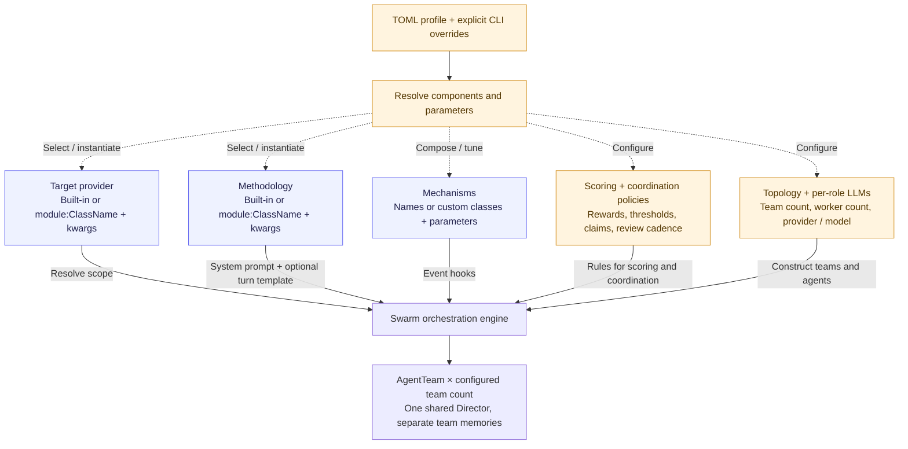

# swarmhound

**A composable multi-agent framework for authorized security research.**

swarmhound runs LLM-driven investigators against a shared scope. A run can use
one team or several teams, different models by role, configurable scoring, and
optional incentive mechanisms. Workers choose tools from the evidence they
collect; a Director reviews progress and can redirect them.

The built-in workflows cover web application security research and bug-bounty
program discovery. Profiles let you change the target source, investigation
methodology, coordination rules, models, and team structure without changing the
orchestration code.

**Experimental software.** Use only on systems you own or are explicitly
authorized to test. Findings and generated reports require human review.


## What is configurable?

A TOML profile describes a run. Named profiles resolve to files in `profiles/`;
explicit CLI options override the corresponding profile options.

| Component | Configuration | What it changes |
|---|---|---|
| Target provider | `[target]` | Explicit targets, program discovery, or a custom source |
| Methodology | `[methodology]` | Worker system instructions and optional turn template |
| Topology | `[topology]` | Engine, teams, and workers per team |
| Models | `[llm.director]`, `[llm.default_worker]`, `[llm.overrides.*]` | Provider and model by role or agent |
| Scoring | `[scoring]` | Finding rewards, rejection/duplicate penalties, termination threshold |
| Coordination | `[coordination]` | Shared/exclusive claims, review cadence, cross-team sharing |
| Mechanisms | `[mechanisms]` | Optional additional incentives and their parameters |

Target providers and methodologies accept built-in names or custom
`module:ClassName` implementations. Mechanisms also support custom classes and
constructor parameters. Custom classes execute Python code: load profiles you
trust. Tool registries are composed in Python; a methodology changes prompts,
not the underlying set of tools by itself.



Example profiles:

- [`bugbounty.toml`](profiles/bugbounty.toml): one team, four workers, baseline scoring.
- [`competitive.toml`](profiles/competitive.toml): three teams of three workers,
  shared claims and additional incentives.
- [`redteam.toml`](profiles/redteam.toml): direct targets with an internal
  red-team methodology.

Profiles are loaded at startup, not hot-reloaded. Omitting `--profile` uses
code defaults rather than loading `bugbounty.toml`. Use a profile or an explicit
`--mode swarm` when you want the swarm engine.

## How a swarm run works

1. **Resolve scope.** Use explicit targets or discover programs and ask the
   Director to select them. The pipeline enriches scope where available.
2. **Investigate.** Each worker calls its LLM to choose tools, processes the
   results, and rebuilds its next-turn context. Workers coordinate through
   their team's claims, notes and findings.
3. **Respond to progress.** Team monitors ask the shared Director for redirects
   and score adjustments. Workers below the configured score threshold can be
   terminated and replaced, subject to replacement limits.
4. **Re-test findings.** A validator starts after findings appear. Multi-team
   runs use a cross-team auditor reading a merged view of team findings.
5. **Collect and report.** The pipeline collects findings, optionally synthesizes
   attack chains, requests a Director debrief and generates Markdown reports.

Teams have separate SharedMemory instances but share the Director, cost tracker,
message bus and persistent storage. The optional knowledge graph is shared too.
Submission scoring and persistence happen **before validation**; the report
handoff is not a verified-only gate.

The `lab` engine instead runs discovery, recon, scan, analysis and reporting
stages. Not every swarm profile feature is consumed by that path.

See the [architecture reference](docs/architecture.md) for runtime feedback
loops, extension hooks and current limitations. The same diagrams are available
as an [HTML page](docs/architecture.html); download/open it in a browser with
internet access to render Mermaid.

## Install

Requirements: Python 3.13+, Docker with Compose, and a configured LLM provider.
Playwright supplies the browser used by browser tools.

```bash
git clone https://github.com/tsirolnik/swarmhound.git
cd swarmhound
python3 -m venv .venv
source .venv/bin/activate
pip install -r requirements.txt
playwright install chromium
cp .env.example .env
docker build -t bugbounty-tools:latest -f docker/Dockerfile.tools .
```

Edit `.env` before running. The example below uses Claude for all agent roles:
set `ANTHROPIC_API_KEY` and a `CLAUDE_MODEL` available to your account.

Providers implemented in the code are `claude`, `ollama`, `openai`
(OpenAI-compatible endpoints), `gemini`, and `vertex`. Set per-role providers
through a profile or the `--director-llm`, `--worker-llm` and `--analyzer-llm`
flags. Setting `LLM_PROVIDER` alone does not configure every role in `full`.
Without role overrides, the configuration map defaults to a Claude Director
and Ollama workers.

OpenAI-compatible endpoints also need `OPENAI_INPUT_PRICE` and
`OPENAI_OUTPUT_PRICE` in USD per million tokens, or an explicit
`OPENAI_FREE_ENDPOINT=true` for a genuinely free endpoint. Ollama requires a
running server and a downloaded model matching `OLLAMA_MODEL`.

FalkorDB is optional. Graph support defaults to enabled and attempts to start a
local container; set `FALKORDB_ENABLED=false` in `.env` to disable it.
See [`.env.example`](.env.example) for common settings and [config.py](config.py)
for the full settings schema.

## Start with the local lab

The benchmark runner manages its own pinned Juice Shop container and network.
Keep port 3000 available; do not start a separate target container first.

```bash
# Preview only: no target startup and no model calls.
python benchmark/run_benchmark.py --targets juice-shop --dry-run \
    --director-llm claude --worker-llm claude --analyzer-llm claude \
    --budget 8 --agents 3 --timeout 2400

# Execute against the local target; this makes paid model calls.
python benchmark/run_benchmark.py --targets juice-shop \
    --director-llm claude --worker-llm claude --analyzer-llm claude \
    --budget 8 --agents 3 --timeout 2400
```

The runner waits for target health, launches the swarm, writes results under
`benchmark/results/`, then stops the target. Findings and coverage vary; zero
findings is a possible outcome. Its class-match metric, named `precision` in
output, does not establish that a reported instance is exploitable.
See the [benchmark guide](benchmark/README.md) for details and cleanup.

## Run a profile

For your own authorized target, replace the example domain below:

```bash
python main.py full --profile bugbounty \
    --targets your-authorized-target.example \
    --director-llm claude --worker-llm claude --analyzer-llm claude \
    --budget 8 --web
```

Switch to `--profile competitive` for the multi-team example. Override its team
and worker counts with `--num-teams` and `--swarm-agents`. Leave out `--targets`
with the `auto` target provider to use program discovery instead. Review the
program's actual authorization and scope before testing.

With `--web`, open the dashboard address shown in the terminal and enter the
printed access token. The dashboard displays activity and supports run controls
and directives. `WEB_AUTH_TOKEN` supplies a reusable token; otherwise one is
generated at startup. Keep the default localhost binding. API clients must use
Bearer authentication; WebSockets also require a matching Origin.

Other entry points:

```bash
python main.py --help
python main.py full --help
python main.py full --list-checkpoints
python main.py costs
python main.py history
```

Saved swarm checkpoints can be selected with `full --resume` or
`--resume-scan NAME_OR_ID`. Reapply the intended profile and provider settings;
checkpoint support is not a promise of seamless recovery for every topology.

## Boundaries

- **Scope checks are application checks.** They reject recognized out-of-scope
  hosts but cannot enforce egress for arbitrary code, redirects or browser
  subrequests. Use external network controls where strict boundaries are needed.
- **Tools run in different places.** CLI tools and generated code run in
  resource-limited Docker containers without host filesystem mounts. HTTP and
  browser tools run in the host process. Docker bridge networking is not a
  host/LAN firewall.
- **Budgets are estimates.** Pricing, usage reporting and concurrent calls can
  cause overshoot. Use provider-side limits as well.
- **Outputs are evidence to review.** Neither model-generated verdicts nor
  benchmark class matching establishes correctness. Competition improving
  investigation quality remains a research question.
- **Logs can contain sensitive material.** Runtime data and reports are ignored
  by Git, but you must review them before sharing.

## Development

```bash
python -m unittest discover -s tests
```

The suite includes regression checks for dashboard authentication, scope
matching, configured pricing, Docker cleanup and pipeline controls. It does
not replace an end-to-end run with your chosen models and environment.

## License

[MIT](LICENSE) © Yehonatan Tsirolnik
