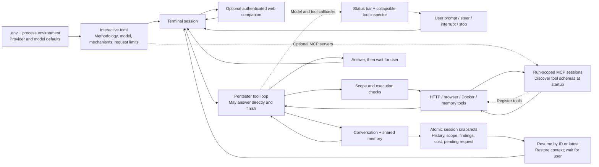
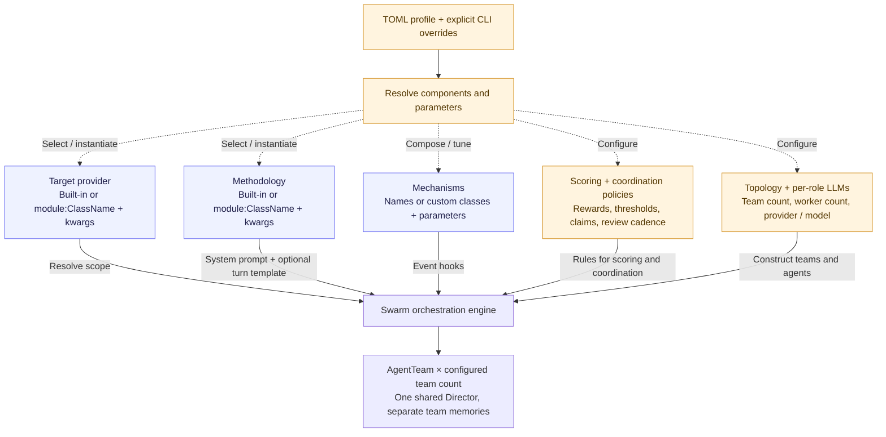
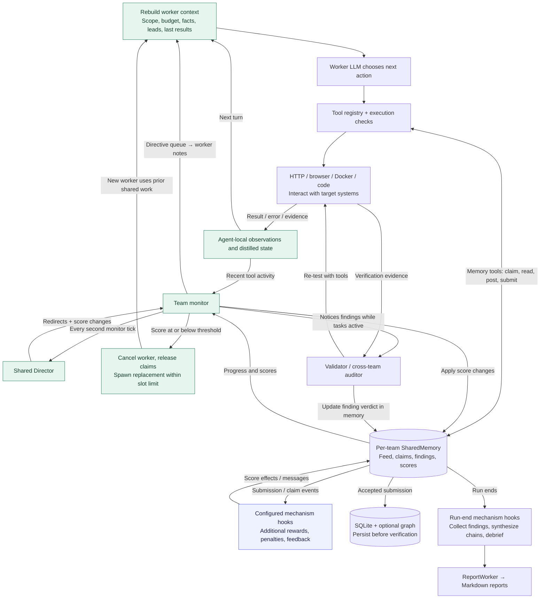

# fantasma — A configurable engine with runtime feedback

With an explicit swarm profile, the framework is **assembled at startup**, then
**adapts while it runs**. These diagrams describe the current swarm path; the
profile-driven lab path uses a sequential workflow instead. Omitting both
profile and mode opens the interactive pentester profile.
Bug-bounty research is one configuration of the swarm engine. The diagrams below
show both kinds of dynamism: component selection and feedback during execution.

## Interaction and execution are separate

`[topology]` selects pentester, swarm or lab execution. `[interaction].mode`
selects terminal or batch interaction where supported. The optional dashboard
is independent and available alongside either via `--web` or `[dashboard] enabled = true`. Swarm and lab terminal
adapters wait for `/start`, route directives, expose controls and resolve checkpoints.
The default profile combines pentester execution with terminal conversation.
See the [interaction reference](interaction.md) for the capability matrix.

## Default: an interactive pentester

The default is [interactive](interactive.md): one user-led pentester waiting for
requests, with no autonomous discovery or Director. Swarm and lab are explicit
profile choices. The following diagram is the interactive path; the numbered
sections afterward describe the batch swarm engine.

Profile-configured [MCP servers](mcp.md) contribute tools to tool agents across
all three execution topologies. Sessions last for the full command; tool catalogs
are discovered at startup, not hot-reloaded. Lab requires tool workers.

## 1. Compose the run

Purple components support built-in names or custom Python classes. Gold nodes
configure behavior and topology. Dotted arrows describe configuration applied
when constructing a run—not live hot-swapping.

| Change in the profile | What changes in the running system |
|---|---|
| `[target] provider` and extra fields | How scope is obtained; custom provider classes receive extra fields as constructor arguments |
| `[methodology] type` and extra fields | How workers are instructed to reason; built-ins support additional instructions and a turn-template override |
| `[mechanisms] enabled` / `[[mechanisms.items]]` | Which event-driven incentives run and their parameters; custom mechanism classes are supported |
| `[scoring]` | Accepted/rejected/duplicate scores and the worker termination threshold |
| `[coordination]` | Exclusive/shared claims, monitor cadence, cross-team intelligence sharing |
| `[topology]` | Team count and workers per team; multi-team runs use AgentGroup on the same swarm engine |
| `[llm.director]`, `[llm.default_worker]`, `[llm.overrides.*]` | Provider/model by lookup role; swarm workers use `scanner`, validators/auditors use `validator` |

For example, `profiles/competitive.toml` selects three teams of three workers,
shared claims, tuned mechanism bonuses, and distinct Director/worker models.
`profiles/bugbounty.toml` selects one team of four workers without additive
mechanisms. Those are data choices, not separate orchestration implementations.

## 2. Adapt during execution

Green nodes form feedback loops. The worker does not follow a fixed scanner
sequence: it chooses the next tool from the latest state. Monitoring and
validation run concurrently with that loop.

**What changes live:**

- Tool outcomes update observations, repeated-endpoint tracking and distilled
  facts/leads. The next worker prompt is rebuilt from that state.
- Director reviews run every second monitor tick and return redirects and score adjustments. Team monitors apply
  them; directives enter worker notes for context distillation.
- Accepted/rejected findings and claims trigger the configured mechanism hooks.
  Scores can influence subsequent behavior and worker lifecycle.
- Low-scoring workers can be terminated and replaced. Claims are released and a
  replacement is instructed to consult prior shared work; respawns have a limit.
- A monitor tick that notices findings can start a validator or cross-team auditor.
  Its verdict updates the selected in-memory finding objects while workers continue;
  duplicate copies across teams are not all synchronized.
- The dashboard can pause/resume/stop the run, change its effective budget and
  inject directives through PipelineBridge. Group monitoring checks the shared
  budget and optionally broadcasts cross-team intelligence.

**What the diagram does not imply:** profiles are not hot-reloaded mid-run;
workers do not rewrite the profile or automatically choose a new model. A
verification verdict does not itself trigger the submission persistence callback.
Report handoff is not restricted to verified findings. The group monitor does
not dynamically reallocate budget between teams.

## 3. Extension hooks and implementation boundaries

| Event / extension | Actual connection |
|---|---|
| Submission | `SharedMemory.submit_finding` → quality gates / dedup / base scoring → persistence on acceptance → `on_submit` effects |
| Claim | Shared-memory claim handling → `on_claim` effects |
| Turn | `turn_lines()` → `on_turn`; called once by both the history-based digest and the rebuilt-context pentester briefing |
| Director review | `director_lines()` → `on_director_review` for additional review context |
| Run completion | `apply_run_end()` → configured end-of-run bonuses |
| Tool extension | `ToolRegistry.register()` / `merge()` allow tool composition in code; there is no general TOML tool-plugin loader shown here |

Mechanisms may be installed Python classes or local files beside the profile.
Each enabled instance can gate its hooks with `when`: hook names, worker IDs,
and submission-only target/severity/acceptance filters. Nonmatching events skip
the hook entirely, including its state changes. Base scoring still runs.
See [custom mechanisms](mechanisms.md) for examples and
[configuration](configuration.md) for inspection commands and precedence.

The optional graph supplies context through graph tools and receives findings.
An optional recorder also writes shared-memory observations to the graph; the
current multi-team recorder watches the first team only. SQLite, the graph,
MessageBus, CostTracker, Director and browser pool are shared run services.
SharedMemory, claims, scores and workers belong to individual teams. Browser
sessions and local observations belong to individual agents.

The [lab profile](lab.md) selects its target provider, role models, worker mode
and enabled sequential stages (recon → scan → analyze → report by default).
Swarm-only mechanisms and coordination do not apply to lab. The diagrams above
describe swarm feedback; lab stages consume the preceding stage outputs and
retain Director evaluation between stages.

## Accuracy boundaries

- The default rebuilt turn briefing remains bug-bounty-oriented even when the
  system methodology changes; `turn_template` is a separate override.
- Validator launch is monitor-driven, not immediate or guaranteed for every
  accepted finding. Validation may stop before all findings are checked.
- Multi-team live API/checkpoint compatibility references the first team's
  SharedMemory. Checkpoints do not restore all team or mechanism private state.
- Persistence arrows mean attempted writes; an accepted finding can remain only
  in memory if a write fails. Verdict mutations do not automatically re-persist.
- The team monitor is orchestration code, not a separate TeamLead model. There is
  one shared Director; the group monitor does not autonomously redistribute budget.

The [runtime reference](reference/runtime.md) documents exact timing, ownership,
deduplication and recovery behavior. See the [documentation index](README.md)
for command, settings, model and extension API references.

## Code behind the diagram

- [profiles/loader.py](../profiles/loader.py): class resolution, constructor kwargs, policy and model configuration
- [commands/full.py](../commands/full.py): CLI precedence and assembly of the pipeline
- [agents/methodology.py](../agents/methodology.py), [agents/target_provider.py](../agents/target_provider.py): replaceable strategies
- [agents/tool_agent.py](../agents/tool_agent.py), [agents/turn_context.py](../agents/turn_context.py): tool loop and state rebuilding
- [agents/team.py](../agents/team.py): reviews, redirects, termination and replacement
- [agents/group.py](../agents/group.py): team orchestration, auditor and cross-team intelligence
- [memory/shared.py](../memory/shared.py), [memory/mechanisms.py](../memory/mechanisms.py): hook dispatch and scoring effects
- [agents/swarm_pipeline.py](../agents/swarm_pipeline.py): persistence, finalization and report handoff
- [web/bridge.py](../web/bridge.py): live human controls

Checked against the repository on **24 October 2026**.
